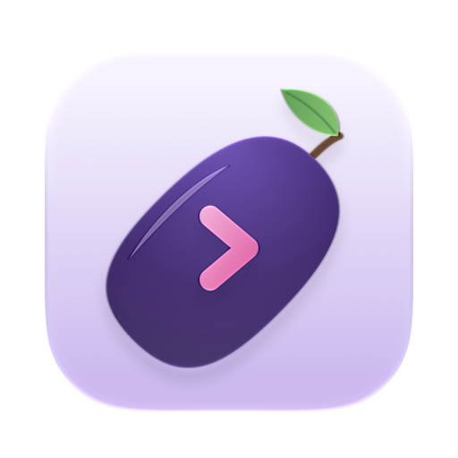
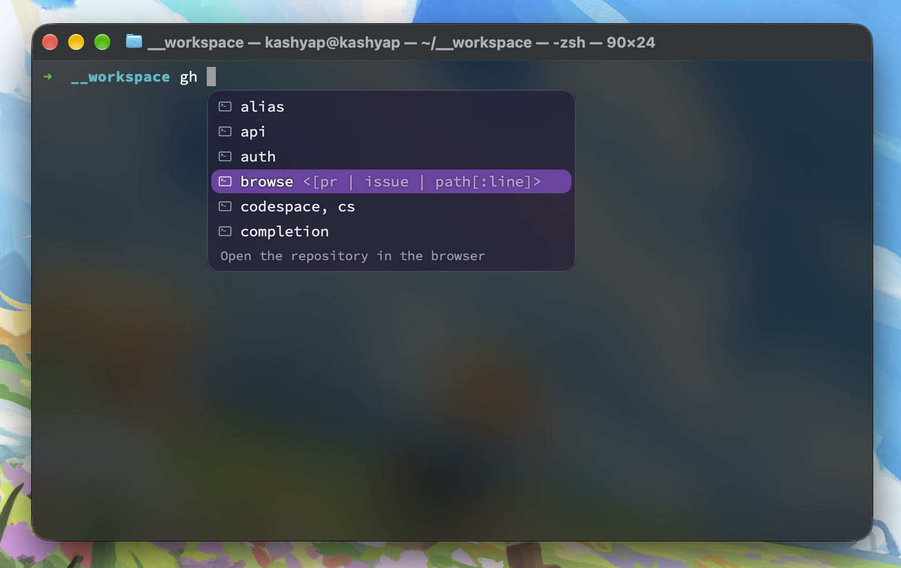

# Jamun

Command suggestions with a nice completion popup for **zsh on macOS**, Powered Fig completion engine.



Works in macOS terminal and VSCode, haven't tested elsewhere.

**Install**

Requires Node.js 22.16+, macOS 13+, and Xcode with the macOS 26+ SDK.

```sh
npm ci
npm run build
```

1. Move `build/Jamun.app` to Applications and open it.
2. Choose **Set Up Shell Integration…** from the Jamun menu.
3. Grant **Accessibility** access, then open a new terminal window.

**Updating and sharing**

- To update, quit Jamun, replace the app in Applications, and open it again. The shell integration refreshes itself on launch; open a new terminal window afterwards. The version is at the top of the Jamun menu.
- To share a build, run `npm run release` and send `build/release/Jamun-<version>-<arch>.zip`. It runs on Apple Silicon Macs only.
- The build is not notarized, so on another Mac the first launch is blocked. Open it once, then go to System Settings → Privacy & Security and choose **Open Anyway**.

**Keys**

| Key | Action |
| --- | --- |
| ↑ / ↓ | Move through suggestions |
| Tab | Complete the shared prefix |
| Enter | Insert the selected suggestion |
| Esc | Dismiss the popup |
| Ctrl+K | Toggle the description |
| Ctrl+R | Toggle history suggestions |

To make Esc respond instantly, Jamun lowers zsh's `KEYTIMEOUT` to 10ms, the minimum zsh allows, while you edit a line (zsh otherwise waits 400ms after Esc). If you use slow two-key bindings such as `jk` in vi mode, set `JAMUN_KEYTIMEOUT` in `~/.zshrc` before Jamun loads: a value in hundredths of a second, or `0` to leave `KEYTIMEOUT` alone.

**Settings**

Edit `~/.jamun/settings.json`, then choose **Reload Autocomplete** from the menu:

```json
{
  "autocomplete.onlyShowOnTab": true,
  "autocomplete.fontSize": 14,
  "autocomplete.width": 360
}
```

**Good to know**

- No suggestions? Choose **Show Diagnostics…** from the menu.
- Other terminal apps work only if they expose the caret through Accessibility. Remote SSH sessions are not supported yet.
- To uninstall, choose **Remove Shell Integration…**, quit Jamun, and delete the app.

**Development**

```sh
npm run check
npm run build
```

More in the [development guide](DEVELOPING.md), [protocol](PROTOCOL.md), and [validation status](IMPLEMENTATION_STATUS.md).

**License**

[MIT](LICENSE). Includes code from the Fig autocomplete engine and other projects under their own licenses: see the [upstream notices](THIRD_PARTY_NOTICES.md).
